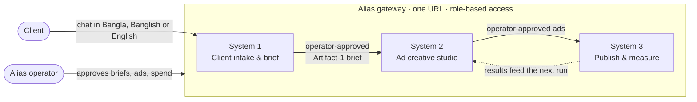

# Alias — an AI marketing agency for small online sellers

> **CommerceSphere AI · GrowthPilot** — International AI Builders Congress 2026
> Your marketing team, run by AI agents and checked by people.

Alias plans a campaign with the client in a chat, turns the client's **real product photos** into
platform-ready ads, publishes them to the client's Facebook page and tracks what sells. Three AI
systems work behind **one address**, with a human operator approving every decision that matters.

|                                   |                                          |
| --------------------------------- | ---------------------------------------- |
| **Live app**                      | https://alias-sand.vercel.app            |
| **UI prototype**                  | https://munirakhondoker.github.io/alias/ |
| **Demo — client**                 | `demo@alias.local` / `AliasDemo#2026!`   |
| **Demo — operator (super admin)** | `admin@alias.local` / `AliasAdmin#2026!` |

## The problem

Millions of small shops in Bangladesh sell through Facebook and Instagram and run their own
marketing. They boost posts with **no brief, no strategy and no testing**, write their own ad copy
and cannot tell which ad brought sales.

- Agencies are too expensive for them; Meta Ads Manager assumes marketing skill.
- Generic AI tools invent fake product images and unverified claims, which hurts trust and gets
  ads rejected.
- **Outcome we change:** lower cost per customer (CAC) and higher conversion on the same ad budget.

## The solution: three systems, one gateway, one rule

**AI proposes; deterministic code and a human operator decide.**



| System                                                     | What it does                                                                                                                                                                                                                                                                     | Key guarantees                                                                                                                                |
| ---------------------------------------------------------- | -------------------------------------------------------------------------------------------------------------------------------------------------------------------------------------------------------------------------------------------------------------------------------- | --------------------------------------------------------------------------------------------------------------------------------------------- |
| **1 · Client intake & brief** (`systems/s1-client-intake`) | An AI consultant chats with the client, extracts several facts per message and asks only for what is missing. The chat becomes an immutable **Artifact-1** brief that an operator edits and approves. Approved briefs trigger competitor research.                               | Client statements stored apart from AI research; versioned briefs; fail-closed source validation; operator copilot drafts replies.            |
| **2 · Ad creative studio** (`systems/s2-ad-creative`)      | Five agents — Brief Analyst, Campaign Strategist, Creative Director, Copywriter, Production & QA — produce angles, copy and a production spec. A deterministic engine composites the **real product cutout** onto an AI-generated background and renders text and logos in code. | Product photos never regenerated; claim and price locks; deterministic QA scorecard (contrast, bounds, sizes) before an operator sees the ad. |
| **3 · Publish & measure** (`systems/s3-publish`)           | Publishes approved posts to the client's Facebook page through the Zernio API, maps every post ID and shows reach, impressions, reactions, comments, shares and clicks.                                                                                                          | API keys server-side only; three IDs stored per post; `no_data_yet` instead of fake zeros.                                                    |
| **Platform** (`apps/web`, `apps/api`)                      | One gateway on one URL: clients get only the chat; operators get the **Systems & agents** console.                                                                                                                                                                               | Better Auth, email verification, TOTP 2FA, server-side RBAC, audit logs.                                                                      |

## AI approach (input → AI → output)

| Step        | Input                                                  | AI                                                                        | Output                                            |
| ----------- | ------------------------------------------------------ | ------------------------------------------------------------------------- | ------------------------------------------------- |
| Intake      | Client messages (Bangla / Banglish / English), uploads | Gemini (`@google/genai`), lightweight model for chat, local rule fallback | Structured brief fields, gaps marked `[UNKNOWN]`  |
| Brief       | Locked chat transcript                                 | Brief synthesis to strict JSON                                            | Immutable Artifact-1 (v1), operator-edited v2, v3 |
| Research    | Approved brief only                                    | Tavily web search + fail-closed validation                                | Artifact-2 research insights                      |
| Creative    | Brief + research + budget plan                         | Strategist, creative and copy agents (Pydantic schemas)                   | Angles, ad copy, production spec                  |
| Render & QA | Real product photo + spec                              | AI background only; code composites                                       | Final ads + QA scorecard                          |
| Publish     | Approved ad                                            | — (deterministic)                                                         | Live post + analytics snapshots                   |

**Bangla first:** the intake agent answers in the client's own language (Bangla script, Banglish or
English) and System 2's typography engine detects Bangla script in ad copy.

**Responsible AI:** no client data is used for training; claims are checked against confirmed facts;
every brief and launch is approved by a human; every admin action is audit-logged.

## Impact and roadmap

We measure **CAC and conversion per campaign**, **time from first chat to live ad** and **share of
ads approved without rework**.

Next: paid boosting under a hard spend cap (Zernio Ads API) · a learning loop where the winning
angle and budget split feed the next run · one login, one database and one campaign state machine
for all three systems · Bangla-first ad typography.

## Team

| Member                | Role                                                                              |
| --------------------- | --------------------------------------------------------------------------------- |
| Shahriar Khan Sakib   | Team lead, domain expert · platform architecture, auth, gateway, integration      |
| Asraful Islam Afridi  | Full-stack developer · System 1: client intake, operator console, brief artifacts |
| Anninda Raj Das       | Full-stack developer · System 2: creative pipeline, compositing, QA               |
| Linkon Biswas         | AI/ML engineer · System 3: Zernio publishing, analytics, tracking                 |
| Munira Khondoker      | Product / UX designer · interactive prototype                                     |
| Kazi Mohaiminul Islam | Product / UX designer · Non-Resident Bangladeshi (USA), remote                    |

All three systems were built in separate repositories and merged here **with their full Git
history** (`git log -- systems/`).

## Run it locally (one address, one command)

```bash
docker compose up -d                 # PostgreSQL 18 + Mailpit
pnpm install
pnpm db:migrate && pnpm seed:demo    # platform tables + the demo accounts above
pnpm setup:systems                   # installs Systems 1-3, creates .env files, runs migrations
pnpm dev:all                         # open http://localhost:3000
```

Environment files and ports: [`systems/README.md`](systems/README.md) · Gateway design:
[`docs/integration/agent.md`](docs/integration/agent.md) · ADRs: [`docs/adr`](docs/adr).

---

## Developer guide: platform foundation

Modular-monolith TypeScript foundation built with pnpm workspaces, Turborepo, Next.js 16 (App Router), Hono OpenAPI, Drizzle ORM + PostgreSQL 18, Better Auth, and Mailpit.

### Architecture Overview

- `apps/web` — Next.js 16 frontend presentation layer with a same-origin `/api/[...path]` proxy to `apps/api`.
- `apps/api` — Hono OpenAPI REST backend enforcing strict inward modular boundaries (`domain/`, `application/`, `infrastructure/`, `http/`, single `index.ts` barrel per module).
  - `modules/authn`: Better Auth session & identity lifecycle (email/password, email verification, Google OAuth, TOTP `twoFactor`, DB-backed `rate_limit`). Never imports `authz` or `platform-admin`.
  - `modules/authz`: Server-side `AuthorizationEngine` backed by PostgreSQL (`roles`, `role_permissions`, `platform_role_assignments`, `platform_security_settings`, `audit_logs`).
  - `modules/platform-admin`: Platform control plane endpoints, guarded security policy management, and advisory-locked `super_admin` CLI bootstrap.
- `packages/contracts` — Pure Zod v4 schemas and DTOs.
- `packages/config` — Shared TypeScript presets and ESLint architectural boundary rules (`pnpm lint:arch`).

### Local Development Setup

1. Start PostgreSQL 18 and Mailpit:

   ```sh
   docker compose up -d --wait
   ```
2. Install workspace dependencies:

   ```sh
   pnpm install
   ```
3. Configure `.env` from `.env.example` (already provisioned locally if created during bootstrap).
4. Apply reviewed forward-only SQL migrations and seed system roles:

   ```sh
   pnpm db:migrate
   ```

   (Or run `pnpm db:reset` on localhost to drop/recreate schemas, apply all migrations, and seed system roles.)
5. Start development servers:

   ```sh
   pnpm dev
   ```

### Demo Accounts

For local demos and judging, create two verified accounts (no email inbox needed):

```bash
pnpm db:migrate
pnpm seed:demo
```

| Role                 | Email               | Password           | Lands on                            |
| -------------------- | ------------------- | ------------------ | ----------------------------------- |
| Client               | `demo@alias.local`  | `AliasDemo#2026!`  | `/dashboard` (links to Systems 1–3) |
| Platform super admin | `admin@alias.local` | `AliasAdmin#2026!` | `/admin`                            |

The command is idempotent and refuses to run when `NODE_ENV=production`. These are local test
credentials only. The three systems themselves run as separate apps; see `systems/README.md`.

### Initial Super Admin Bootstrap

Register and verify a user account first, then promote it via the advisory-locked CLI bootstrap:

```sh
pnpm bootstrap:admin -- --email admin@example.com
```

### Environment-Aware Platform 2FA Policy

Platform administrator MFA enforcement is controlled by the `platform_security_settings` singleton table (`id = 'default'`) combined with a safe environment default when no database override row exists:

- **`development`:** Defaults to **OFF** (`requirePlatformMfa = false`) for frictionless local development and database resets until an administrator turns it on.
- **`production` and `test`:** Defaults to **ON** (`requirePlatformMfa = true`), requiring personal TOTP enrollment and verification before accessing `/admin` or `/api/v1/platform/*`.

A `super_admin` can toggle the policy at runtime from **Platform Security & 2FA** inside `/admin` (`PATCH /api/v1/platform/security-settings`):

- Turning **ON** requires the calling `super_admin` to have personal 2FA enabled and verified (`409 MFA_SETUP_REQUIRED_BEFORE_ENFORCEMENT` otherwise) to prevent self-lockout.
- Turning **OFF** requires `super_admin` authorization (including MFA verification when the policy is currently ON).
- Every toggle writes an immutable `platform.security.mfa_policy_updated` entry to `audit_logs` inside the same database transaction.

### Verification Commands

- Format & lint: `pnpm format:check && pnpm lint`
- Typecheck: `pnpm typecheck`
- Unit tests: `pnpm test:unit`
- PostgreSQL 18 integration tests: `pnpm test:integration`
- Production build: `pnpm build`
- Playwright E2E tests: `pnpm test:e2e`
