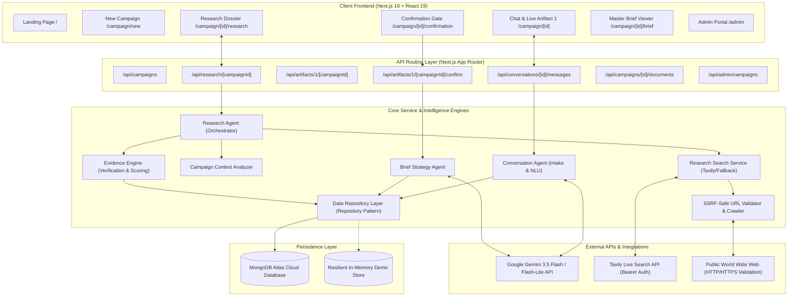
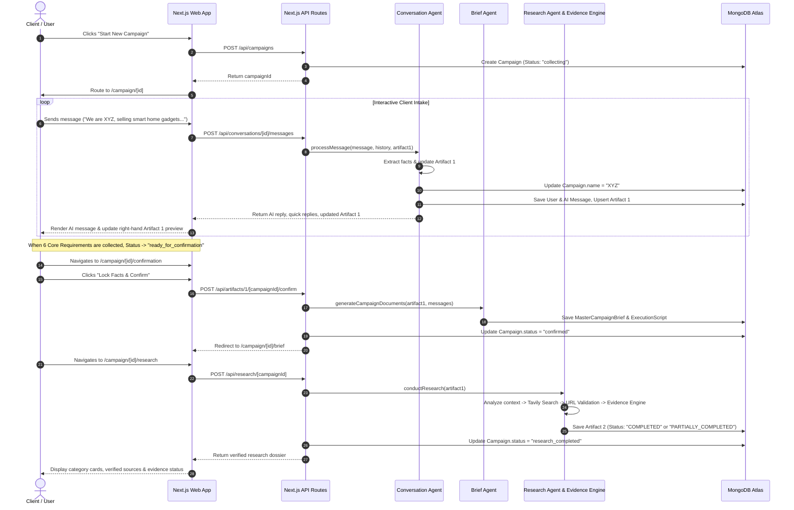
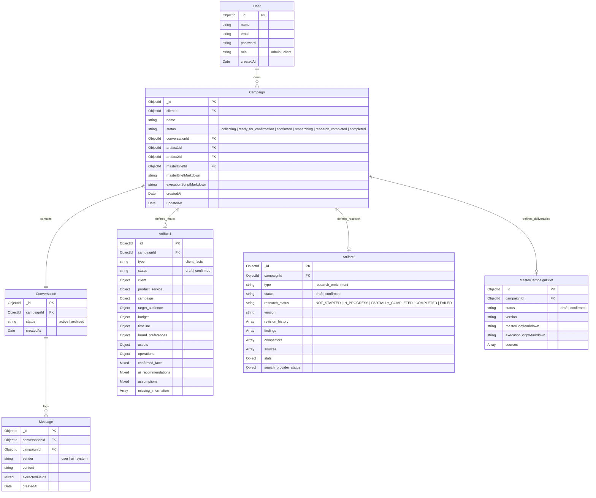

# ALIAS PART 1 — Complete Project Context & Technical Handover Report

> **Document Type:** Production Handover & Architectural Blueprint  
> **Target Audience:** AI Engineering Assistants (Claude, ChatGPT, Gemini, etc.) & Software Engineers  
> **Workspace Root:** `c:\Users\LENOVO\OneDrive\Desktop\ALIAS\ALIAS PART 1`  
> **Generation Date:** November 2026  
> **Repository Name:** `ai-agency-mvp` (ALIAS Product Suite - Part 1)  
> **Tech Stack:** Next.js 16.3.6 (Turbopack, App Router), React 19.2.8, TypeScript 5, Tailwind CSS v4, MongoDB Atlas (Mongoose 9.10.2), Google GenAI SDK (`@google/genai`), Tavily Search API, Vitest 5.

---

## 1. Project Overview

### 1.1 Project Name & Purpose
**ALIAS** (Autonomous Lifecycle Intelligence & Advertising System) — Part 1 is an autonomous, AI-driven marketing agency platform. It replaces the traditional, manual client-onboarding, market research, and strategic campaign planning workflows of a creative marketing agency with autonomous AI agents backed by verifiable real-world web evidence.

### 1.2 Problem Being Solved
1. **Inefficient Client Onboarding:** Traditional creative agencies require multiple human meetings, unstructured email questionnaires, and manual brief drafting that takes 1–2 weeks. ALIAS conducts natural, conversational onboarding in minutes, extracting structured client facts into a real-time reactive dossier.
2. **Fabricated / Hallucinated AI Research:** Most generic AI marketing tools hallucinate competitor pricing, cite dead links, invent market statistics, or use training-data biases. ALIAS incorporates a **fail-closed Evidence Engine** and a real-time **Tavily Web Search & URL validation crawler** that verifies live HTTP status, DNS security, and semantic claim support before presenting findings to clients.
3. **Lack of Operational Execution:** Traditional briefs remain high-level slide decks. ALIAS produces both a strategic **Master Campaign Brief** and a beginner-friendly, phone-camera-ready **Campaign Execution Script** tailored to emerging markets (e.g., Bangladesh Cash-on-Delivery, Steadfast/Pathao courier workflows, Meta Ads Manager setups).

### 1.3 Target Users
1. **SME & E-Commerce Business Owners:** Entrepreneurs (e.g., apparel, electronics, local retail, food & beverage, B2B SaaS) who lack an in-house marketing department or the budget for a traditional creative agency.
2. **Agency Account Managers & Consultants:** Professional agency operators who use ALIAS's Admin Dashboard (`/admin`) to supervise multiple client campaigns, review verified dossiers, and export production scripts.

### 1.4 Traditional Agency vs. ALIAS

| Dimension | Traditional Creative Agency | ALIAS Autonomous Agency |
|---|---|---|
| **Intake / Briefing** | 3–5 manual discovery meetings; 7–14 days. | Conversational AI chat with real-time fact extraction into Artifact 1 in <15 minutes. |
| **Market Research** | Junior strategist browsing Google; static slide decks. | Autonomous Research Engine with Tavily live search, SSRF protection, HTTP redirect tracking, and Evidence Engine claim mapping. |
| **Fact Verification** | Unverified claims; subjective assumptions. | Strict separation: Confirmed Facts vs. AI Recommendations vs. Assumptions vs. Missing Info. |
| **Competitor Audit** | Manual catalog browsing; third-party directory confusion. | Automated domain discovery rejecting Wikipedia/LinkedIn/directory profiles as official websites. |
| **Output Deliverable** | Expensive PDF pitch deck. | Dynamic Artifact 1 (Intake), Artifact 2 (Live Evidence Dossier), and Master Brief + Execution Guide. |
| **Cost & Speed** | Thousands of dollars; weeks of turnaround. | Sub-minute AI execution; minimal API operational costs. |

### 1.5 Product Vision & User Capabilities
Using ALIAS, a client can:
1. Start a new marketing campaign via `/campaign/new`.
2. Converse naturally with an AI marketing consultant in English, Bengali, or Banglish.
3. Watch their business profile, product details, budget, timeline, and audience dynamically populate on a side-by-side live preview (Artifact 1).
4. Lock and confirm their campaign facts through a strict 6-core-requirement validation gate.
5. Trigger deep, automated market research that queries live web search APIs, validates external URLs, checks competitor stores, and produces a tamper-proof evidence dossier (Artifact 2).
6. Export an exhaustive, ready-to-run Master Campaign Brief and day-by-day practical Execution Script.

---

## 2. Complete System Architecture

### 2.1 High-Level Architecture Diagram (Mermaid)



### 2.2 Frontend Architecture
- **Framework:** Next.js 16.3.6 using the new **App Router** (`src/app/`).
- **React Version:** React 19.2.8 (`"react": "19.2.8"`, `"react-dom": "19.2.8"`).
- **Styling:** Tailwind CSS v4 (`@tailwindcss/postcss`) with CSS variables (`src/app/globals.css`).
- **Component Library:** Custom UI components utilizing Lucide icons (`lucide-react`), Radix/Base-UI primitives (`@base-ui/react`), and utility helpers (`clsx`, `tailwind-merge`).
- **State & Data Synchronization:** Client components use React hooks (`useState`, `useEffect`, `useCallback`, `useRef`) paired with direct REST fetches to Next.js API routes. Polling and mutation triggers keep Artifact 1 and Artifact 2 preview cards updated in real time.

### 2.3 Backend Architecture
- **Next.js Serverless Route Handlers:** Located in `src/app/api/`. Every endpoint is strictly typed, handles route params asynchronously (`params: Promise<{ id: string }>`), and formats responses via `NextResponse.json()`.
- **Repository Pattern:** Located in `src/lib/db/repo.ts`. All MongoDB queries and in-memory fallbacks are encapsulated inside a single `Repository` object, abstracting Mongoose models from API routes.
- **Fail-Safe Database Resilience:** If MongoDB Atlas is unreachable or times out, `dbConnect()` (`src/lib/db/connect.ts`) detects the failure within 2.5 seconds, caches the failure state for 60 seconds, and seamlessly switches to an in-memory storage fallback (`memoryStore`) unless `ALLOW_MEMORY_FALLBACK=false` is enforced.

### 2.4 AI Integration Architecture
- **SDK:** Official Google GenAI SDK (`@google/genai` v2.30.0) combined with optional OpenAI SDK (`openai` v7.23.0).
- **Primary Model:** `gemini-3.5-flash` (or `gemini-3.5-flash-lite` configured via `GEMINI_MODEL`).
- **Resilience Strategy:** Exponential backoff retry loop (up to 2 retries on HTTP 429/503 transient errors) with automatic fallback to secondary models (`gemini-3.5-flash` / `gemini-flash-latest`) before throwing `AiUnavailableError`.
- **Output Parsing:** Deterministic JSON isolation using `robustParseJson()` (`src/lib/ai/conversation-agent.ts`), which cleans markdown backticks, strips stray bullets inside arrays, and sanitizes control characters.

---

## 3. Complete User Workflow



### Stage-by-Stage Breakdown

#### Stage 1: Session Initialization
- **Component:** `src/app/campaign/new/page.tsx` -> `POST /api/campaigns`.
- **Action:** Creates an initial campaign record, generates an associated `Conversation` record, and redirects the browser to `/campaign/[id]`.
- **Status:** **Implemented & Verified.**

#### Stage 2: Conversational Onboarding & Live Fact Extraction
- **Component:** `src/components/chat/ChatInterface.tsx`, `src/app/api/conversations/[id]/messages/route.ts`, `src/lib/ai/conversation-agent.ts`.
- **Action:** The client speaks naturally. The AI recognizes company names, products, objectives, target audiences, budgets, and timelines. It immediately updates `Campaign.name` and saves structured fields in `Artifact1`.
- **Status:** **Implemented & Verified.**

#### Stage 3: Confirmation Gate
- **Component:** `src/app/campaign/[id]/confirmation/page.tsx` -> `POST /api/artifacts/1/[campaignId]/confirm`.
- **Action:** Validates the presence of the 6 essential facts (Brand, Product, Objective, Audience, Budget, Timeline). Locks Artifact 1 with `status: "confirmed"`. Generates the preliminary brief documents.
- **Status:** **Implemented & Verified.**

#### Stage 4: Verified Autonomous Market Research (Artifact 2)
- **Component:** `src/app/campaign/[id]/research/page.tsx` -> `POST /api/research/[campaignId]`.
- **Action:** The Research Agent analyzes the confirmed Artifact 1, generates targeted search queries, queries the Tavily Search API, validates URLs against SSRF and HTTP errors, and maps evidence claims into a structured `ResearchDossier`.
- **Status:** **Implemented & Verified.**

#### Stage 5: Final Deliverables (Master Campaign Brief & Execution Script)
- **Component:** `src/app/campaign/[id]/brief/page.tsx` -> `GET /api/campaigns/[id]/documents`.
- **Action:** Displays the comprehensive strategic brief and step-by-step phone-camera execution script with copy-to-clipboard and markdown download capabilities.
- **Status:** **Implemented & Verified.**

#### Stage 6: Ad Publishing & Media Execution (Planned)
- **Component:** Direct Meta Ads Manager / Google Ads API connectors.
- **Status:** **Not Implemented (Future Roadmap).**

---

## 4. AI Agents and Their Responsibilities

| Agent / Subsystem | Purpose & File Path | Inputs | Processing Logic | Outputs | Models / APIs Used | Status |
|---|---|---|---|---|---|---|
| **Orchestrator / Controller** | Next.js API Routes (`src/app/api/`) & Repository (`src/lib/db/repo.ts`) | HTTP Requests, Campaign IDs | Deterministic state machine governing transitions: `collecting` -> `ready_for_confirmation` -> `confirmed` -> `researching` -> `research_completed` -> `completed`. | JSON HTTP responses, DB updates | None (Deterministic Code) | **Completed & Verified** |
| **Conversation AI / Client Intake Agent** | `src/lib/ai/conversation-agent.ts` | User chat messages, chat history, current Artifact 1 | Intent recognition, brand name extraction, budget parsing, correction detection, question sequencing. | Assistant reply text, extracted delta updates, dynamic quick replies, status flag. | Google Gemini 3.5 Flash (`@google/genai`) with OpenAI fallback | **Completed & Verified** |
| **Campaign Context Analyzer** | `src/lib/research/campaign-analyzer.ts` | Confirmed Artifact 1 facts | Evaluates business model hints (B2B SaaS, E-com, Retail), determines research depth, selects categories, formulates targeted search queries. | `AnalyzedCampaignContext` | None (Deterministic NLP & Rule Engine) | **Completed & Verified** |
| **Research Search Service** | `src/lib/research/search-service.ts` | Targeted queries, industry, location, competitor names | Calls Tavily Search API with 8s timeout; crawls and validates candidate URLs; handles error mapping (401, 402, 429, 500). | `SearchResultCandidate[]`, `ResearchSource[]` | Tavily Search API, Wikipedia OpenSearch | **Completed & Verified** |
| **URL Validator & Crawler** | `src/lib/research/url-validator.ts` | Candidate URLs | DNS resolution, private IP / cloud metadata blocking (SSRF defense), HTTP GET follow-redirects, content scraping. | `UrlValidationResult` | Native Node.js `dns/promises`, `net`, `fetch` | **Completed & Verified** |
| **Evidence Engine (Supervisor / QC)** | `src/lib/research/evidence-engine.ts` | Candidate sources, competitor websites, Artifact 1 | Computes semantic relevance, enforces geographic alignment, matches claims to source excerpts, verifies official competitor domains. | `ResearchDossier` (Artifact 2) with status (`COMPLETED`, `PARTIALLY_COMPLETED`) | None (Rule-Based Semantic Verification) | **Completed & Verified** |
| **Creative Strategy & Brief Agent** | `src/lib/ai/brief-agent.ts` | Artifact 1 facts, Artifact 2 dossier, conversation transcript | Synthesizes client facts and research into structured markdown: Executive Summary, Objectives, Persona, Offer Architecture, Budget Phases, Ad Copy, Execution Steps. | `master_campaign_brief_md`, `campaign_execution_script_md` | Google Gemini 3.5 Flash | **Completed & Verified** |
| **Copywriting Agent** | Embedded inside `src/lib/ai/brief-agent.ts` | Campaign facts, tone, language preferences | Generates Banglish / English ad copy, hooks, headlines, and call-to-actions. | Ad copy sections in brief | Google Gemini 3.5 Flash | **Partially Implemented (Embedded)** |
| **Budget Planning Agent** | Embedded inside `src/lib/ai/brief-agent.ts` & `src/lib/research/campaign-analyzer.ts` | Total budget amount, timeline duration | Computes daily spend and 3-phase split (20% Testing, 60% Core Scaling, 20% Urgency/Retargeting). | Budget distribution tables | Deterministic Math + Gemini | **Partially Implemented (Embedded)** |
| **Campaign Scheduling / Publishing Agent** | *Not created* | Campaign creatives, Meta Ads tokens | Automatic ad set creation and media publishing. | Live ads on Meta / Google | None | **Not Implemented (Roadmap)** |
| **Live Analytics Agent** | *Not created* | Ad spend, ROAS, click-through rates | Ingestion of live Meta/Google metrics and automated budget re-allocation. | Campaign performance reports | None | **Not Implemented (Roadmap)** |

---

## 5. Conversation AI and Client Intake

### 5.1 Conversational Onboarding Mechanism
The intake agent operates through `ConversationAgent.processMessage()` in `src/lib/ai/conversation-agent.ts`. When a message arrives at `POST /api/conversations/[id]/messages`:
1. The message is stored immediately in MongoDB to prevent data loss.
2. The agent inspects prior message history and the existing draft of `Artifact1`.
3. The prompt instructs Gemini to act as a seasoned marketing strategist, extracting business attributes into a strictly typed JSON schema while writing an engaging conversational reply.

### 5.2 Fact Extraction vs. Assumption Separation
To prevent the AI from fabricating client commitments, the system enforces strict boundaries:
- **Client Facts:** Explicit statements made by the user (e.g., brand name, product, price, confirmed budget, delivery courier).
- **AI Recommendations:** Strategic advice generated by the AI (e.g., recommended discount structure, suggested ad formats). These are tagged as `AI Recommendation - Pending Client Approval`.
- **Assumptions:** Benchmark estimates (e.g., target ROAS, estimated message cost). Stored in `artifact1.assumptions` and labeled as unconfirmed.
- **Missing Information:** Tracked in `artifact1.missing_information` and displayed to the user until answered.

### 5.3 Intelligent Fact Extraction Features
- **Punctuation-Resilient Brand Extraction (`extractCleanBrandName`):** Cuts off brand candidates before conversational transition phrases (e.g., `"My brand is Qrew currently I don't have any client"` cleanly extracts `"Qrew"` without trailing clauses).
- **Dynamic Quick Replies (`generateContextualQuickReplies`):** Inspects missing fields and context. If B2B SaaS is detected, it suggests SaaS-relevant objectives and budgets; if apparel is detected, it suggests fashion products and pricing.
- **Intentional Correction Handling:** Detects cues like `"actually"`, `"change brand to"`, `"update budget to"`, allowing clients to modify previous answers without resetting the conversation.
- **Automatic Campaign Naming:** Whenever a brand name is identified or corrected, `Repository.updateCampaignName()` updates `Campaign.name` in MongoDB so campaigns never get stuck with the placeholder name `"New Marketing Campaign"`.

### 5.4 The 6 Core Requirements Gate
Before Artifact 1 can transition from `draft` to `confirmed`, the system verifies:
1. `client.company_name` (Brand Name)
2. `product_service.name` (Product / Service Offering)
3. `campaign.objective` (Primary Marketing Goal)
4. `target_audience` (Location, Demographics, or Description)
5. `budget` (Numeric amount or explicitly stated `"unknown"`)
6. `timeline.duration` (Campaign Duration)

---

## 6. Research AI / External Research System

### 6.1 Architecture & Workflow
The Research Engine (`src/lib/ai/research-agent.ts`) executes an automated, 5-stage research pipeline:
1. **Context Analysis (`CampaignContextAnalyzer.analyze`):** Evaluates Artifact 1 facts, assigns a research depth (`COMPREHENSIVE`, `STANDARD`, or `LEAN`), selects categories, and formulates 4–6 targeted search queries.
2. **Dynamic Search Querying (`ResearchSearchService.searchWeb`):** Executes queries against external APIs.
3. **URL Validation & SSRF Protection (`url-validator.ts`):** Validates every returned URL, follows redirects, ensures no local or private IP addresses are accessed, and extracts text excerpts.
4. **Competitor Discovery (`ResearchSearchService.discoverCompetitors`):** Searches for competitor storefronts and verifies official root domains.
5. **Evidence Synthesis (`EvidenceEngine.buildDossier`):** Maps claims to verified sources, calculates confidence scores, evaluates semantic relevance, and saves the final dossier as `Artifact2`.

### 6.2 External Search Providers
- **Tavily Search API (Active & Verified):** Primary external search engine. Configured via `TAVILY_API_KEY`. Called using `https://api.tavily.com/search` with Bearer authentication, 8-second timeout, and HTTP status code mapping (401 Auth, 402 Quota, 429 Rate Limit, 500 Server Error).
- **SerpApi Google Search (Supported Fallback):** Configured via `SERPAPI_API_KEY` when configured.
- **Wikipedia OpenSearch (Tertiary Fallback):** Used to supplement macroeconomic or encyclopedic context if live search yields fewer than 4 candidates.
- **Curated Institutional Index (Fail-Safe Fallback):** Trusted trade directories (e.g., The Daily Star Business, Dhaka Tribune, World Bank) used only when external APIs are unconfigured or exhausted.

### 6.3 Evidence Engine & Verification Rules
The Evidence Engine enforces a **fail-closed verification policy**:
- **HTTP 200 ≠ Verified:** A source that responds with HTTP 200 is accessible, but is **NOT** marked as supporting evidence unless its extracted text semantically supports the specific claim.
- **Third-Party Domain Rejection:** Social media posts (Facebook, Instagram) and company directory profiles (Tracxn, Crunchbase, ZoomInfo, Wikipedia) are **strictly rejected** as official competitor websites. They are classified as `SEARCH_RESULT_ONLY` or `TERTIARY`.
- **Source Tiers:**
  - `PRIMARY`: Government databases, official statistical bureaus, central banks, academic studies.
  - `SECONDARY`: Established news publications, recognized industry trade reports.
  - `TERTIARY`: Wikipedia, social media posts, company profile aggregators. Tertiary sources can at best produce `PARTIALLY_VERIFIED` claims.
- **Competitor Domain Verification:** Only root domains containing brand tokens that do not redirect to domain brokers (HugeDomains, Sedo) are marked as `is_official_domain: true`.

---

## 7. Database and Data Models

### 7.1 Database Technology
- **Database:** MongoDB Atlas (Cloud Replica Set).
- **ODM:** Mongoose v9.10.2 (`mongoose`).
- **Connection Handler:** `src/lib/db/connect.ts` with connection pooling, short timeouts (2500ms), and automated memory fallback.

### 7.2 Entity Relationship Diagram (Mermaid)



---

## 8. Artifact System

### 8.1 Artifact 1: Client Fact Profile
- **Schema:** `src/models/Artifact1.ts` & `src/lib/validation/schemas.ts` (`Artifact1Schema`).
- **Purpose:** Stores raw, validated facts gathered directly from the client during onboarding.
- **UI Location:** Rendered in real-time in the right-hand panel of `/campaign/[id]` (`LiveArtifactPreview.tsx`) and reviewed at `/campaign/[id]/confirmation`.
- **Status:** **Completed & Verified.**

### 8.2 Artifact 2: Market & Competitor Intelligence Dossier
- **Schema:** `src/models/Artifact2.ts` & `src/lib/research/types.ts` (`ResearchDossier`).
- **Purpose:** Stores external evidence, categorized findings, competitor audit cards, URL validation audit trails, and search provider status.
- **Key Feature:** **Revision History (`revision_history`).** Every time research is regenerated, previous versions are snapshotted into an array, allowing clients to review past revisions without data loss.
- **UI Location:** Rendered at `/campaign/[id]/research` (`ResearchDashboardPage`).
- **Status:** **Completed & Verified.**

### 8.3 Master Campaign Brief & Execution Script
- **Schema:** `src/models/MasterCampaignBrief.ts`.
- **Purpose:** Final production deliverables synthesized from Artifact 1 and Artifact 2.
- **UI Location:** Rendered at `/campaign/[id]/brief` with tab switching, markdown formatting, copy-to-clipboard, and `.md` file download.
- **Status:** **Completed & Verified.**

---

## 9. Complete Codebase Map

```
ALIAS PART 1/
├── src/
│   ├── app/                                 # Next.js App Router (Pages & API Routes)
│   │   ├── admin/
│   │   │   ├── page.tsx                     # Admin Overview Dashboard (Client & Campaign Table)
│   │   │   └── campaigns/[id]/page.tsx      # Admin Campaign Deep-Dive Inspector
│   │   ├── api/
│   │   │   ├── admin/campaigns/route.ts     # GET: All campaigns & system stats
│   │   │   ├── admin/campaigns/[id]/route.ts# GET: Full campaign dossier, messages & artifacts
│   │   │   ├── artifacts/1/[campaignId]/    # GET/POST: Artifact 1 retrieval & updates
│   │   │   │   └── confirm/route.ts         # POST: 6-requirement check & confirmation
│   │   │   ├── auth/[...nextauth]/route.ts  # NextAuth API route
│   │   │   ├── campaigns/route.ts           # POST: Initialize campaign session
│   │   │   ├── campaigns/[id]/route.ts      # GET: Campaign metadata
│   │   │   ├── campaigns/[id]/documents/    # GET/POST: Master brief & script regeneration
│   │   │   ├── conversations/[id]/route.ts  # GET: Conversation messages & quick replies
│   │   │   │   └── messages/route.ts        # POST: Send message, run NLU, update Artifact 1
│   │   │   ├── master-brief/[campaignId]/   # GET: Master Campaign Brief
│   │   │   └── research/[campaignId]/
│   │   │       ├── route.ts                 # GET: Fetch research / POST: Run research pipeline
│   │   │       └── start/route.ts           # POST: Legacy research & brief trigger
│   │   ├── campaign/
│   │   │   ├── new/page.tsx                 # Auto-initiator: Creates campaign & routes to chat
│   │   │   └── [id]/
│   │   │       ├── page.tsx                 # Core Chat & Live Artifact 1 split-screen
│   │   │       ├── confirmation/page.tsx    # 6-Requirement Verification & Fact Locking Gate
│   │   │       ├── research/page.tsx        # Client Research Dossier Dashboard (Artifact 2)
│   │   │       └── brief/page.tsx           # Master Brief & Execution Script Viewer
│   │   ├── login/page.tsx                   # Admin & Client Login UI
│   │   ├── globals.css                      # Tailwind CSS v4 styling & dark mode tokens
│   │   ├── layout.tsx                       # Root layout & NextAuth session provider
│   │   └── page.tsx                         # Landing page introducing ALIAS
│   ├── components/
│   │   ├── campaign/
│   │   │   └── LiveArtifactPreview.tsx      # Reactive right-hand Artifact 1 preview card
│   │   ├── chat/
│   │   │   └── ChatInterface.tsx            # Full chat interface with auto-scrolling & quick replies
│   │   └── ui/                              # Reusable primitives (button, card, input, textarea)
│   ├── lib/
│   │   ├── ai/
│   │   │   ├── brief-agent.ts               # Generates Master Brief & Execution Script via LLM
│   │   │   ├── conversation-agent.ts        # Conversational NLU, fact extraction, quick replies
│   │   │   ├── conversation-agent.test.ts   # Vitest unit tests for intake agent & retry logic
│   │   │   ├── research-agent.ts            # High-level research orchestrator
│   │   │   └── ui-text.ts                   # Multilingual default prompts & greetings
│   │   ├── auth/
│   │   │   └── authOptions.ts               # NextAuth credentials provider configuration
│   │   ├── db/
│   │   │   ├── connect.ts                   # Resilient MongoDB Mongoose connection manager
│   │   │   └── repo.ts                      # Repository Pattern handling all DB/Memory CRUD
│   │   ├── research/
│   │   │   ├── campaign-analyzer.ts         # Industry-agnostic context analysis & query generator
│   │   │   ├── evidence-engine.ts           # Claim-to-source evidence verification & scoring
│   │   │   ├── research.test.ts             # Comprehensive 52-test research engine test suite
│   │   │   ├── search-service.ts            # Tavily Search API client & candidate enrichment
│   │   │   ├── types.ts                     # TypeScript interfaces for sources, findings, dossiers
│   │   │   └── url-validator.ts             # SSRF protection, DNS validation & HTTP redirect crawler
│   │   ├── validation/
│   │   │   └── schemas.ts                   # Zod schemas for Artifact 1, Artifact 2, Master Brief
│   │   └── utils.ts                         # Tailwind CSS class merger (`cn`)
│   └── models/                              # Mongoose Models (Campaign, Artifact1, Artifact2, etc.)
├── scripts/                                 # Verification & audit scripts (Tavily, DB, URLs)
├── package.json                             # Dependencies & scripts
├── tsconfig.json                            # TypeScript configuration
└── vitest.config.ts                         # Vitest configuration for unit test runner
```

---

## 10. API Documentation

| Method | Endpoint | Purpose | Request Body | Response Output | Related Frontend Component |
|---|---|---|---|---|---|
| `POST` | `/api/campaigns` | Initializes a new campaign session | `{ name?: string }` | `{ success: true, campaignId, conversationId }` | `src/app/campaign/new/page.tsx` |
| `GET` | `/api/campaigns/[id]` | Retrieves campaign status & metadata | *None* | `{ success: true, campaign }` | `src/app/campaign/[id]/page.tsx` |
| `GET` | `/api/conversations/[id]` | Fetches chat history & quick replies | *None* | `{ messages: [], quickReplies: [] }` | `ChatInterface.tsx` |
| `POST` | `/api/conversations/[id]/messages` | Sends user message, runs NLU, updates Artifact 1 | `{ message: string }` | `{ aiMessage, artifact, status, quickReplies }` | `ChatInterface.tsx` |
| `GET` | `/api/artifacts/1/[campaignId]` | Retrieves current Artifact 1 data | *None* | `{ success: true, artifact }` | `LiveArtifactPreview.tsx` |
| `POST` | `/api/artifacts/1/[campaignId]` | Manually updates Artifact 1 fields | `{ updates: Object, status?: string }` | `{ success: true, artifact }` | `LiveArtifactPreview.tsx` |
| `POST` | `/api/artifacts/1/[campaignId]/confirm` | Validates 6 core requirements, locks Artifact 1, generates initial brief | *None* | `{ success: true, artifact, documents, redirectTo }` | `ConfirmationPage.tsx` |
| `GET` | `/api/research/[campaignId]` | Fetches Artifact 2 research dossier | *None* | `{ success: true, artifact2, status }` | `ResearchDashboardPage.tsx` |
| `POST` | `/api/research/[campaignId]` | Runs external search, validates URLs, builds Artifact 2 dossier | *None* | `{ success: true, artifact2, research_status, stats }` | `ResearchDashboardPage.tsx` |
| `GET` | `/api/campaigns/[id]/documents` | Retrieves Master Campaign Brief & Execution Script markdown | *None* | `{ success: true, masterBriefMarkdown, executionScriptMarkdown }` | `brief/page.tsx` |
| `POST` | `/api/campaigns/[id]/documents` | Regenerates Master Brief & Execution Script markdown | *None* | `{ success: true, masterBriefMarkdown, executionScriptMarkdown }` | `brief/page.tsx` |
| `GET` | `/api/master-brief/[campaignId]` | Retrieves legacy structured Master Campaign Brief | *None* | `{ success: true, brief }` | Admin inspect pages |
| `GET` | `/api/admin/campaigns` | Lists all campaigns & high-level stats for admin | *None* | `{ success: true, campaigns: [], stats: Object }` | `admin/page.tsx` |
| `GET` | `/api/admin/campaigns/[id]` | Fetches complete campaign data for admin inspection | *None* | `{ campaign, conversation, messages, artifact1, artifact2, masterBrief }` | `admin/campaigns/[id]/page.tsx` |
| `POST` | `/api/auth/[...nextauth]` | Handles user authentication via NextAuth | Credentials `{ email, password }` | Session token & user object | `login/page.tsx` |

---

## 11. Frontend and Admin Dashboard

### 11.1 Client-Facing Application
- **Onboarding Split-Screen (`/campaign/[id]`):** Left pane renders `ChatInterface.tsx` with streaming auto-scroll, multiline expanding textarea, and dynamic quick-reply pills. Right pane renders `LiveArtifactPreview.tsx`, organizing extracted facts into collapsible sections (Business, Offering, Objective, Audience, Budget, Timeline).
- **Fact Confirmation Page (`/campaign/[id]/confirmation`):** Displays a summary card of all confirmed facts. If any of the 6 core requirements are missing, a warning banner lists the missing items and disables confirmation until answered in chat.
- **Research Intelligence Dashboard (`/campaign/[id]/research`):**
  - **Category Filter Tabs:** Allows filtering findings by category (e.g., *Market Dynamics*, *Consumer Behavior*, *Competitor Pricing*, *Payment & Logistics*).
  - **Evidence Status Badges:** Color-coded badges indicating `VERIFIED` (green), `PARTIALLY_VERIFIED` (blue), `UNVERIFIED` (amber), or `CONTRADICTED` (red).
  - **Source Cards:** External links opening in a new tab (`target="_blank" rel="noopener noreferrer"`). Valid sources show direct links; broken or rejected sources are flagged and non-clickable.
  - **Revision History Modal:** Shows all historical revisions of research, allowing users to compare previous findings against the latest run.
- **Brief & Script Viewer (`/campaign/[id]/brief`):** Custom markdown renderer handling headers, lists, bold tokens, code blocks, and markdown tables. Includes one-click copy and `.md` file download.

### 11.2 Admin Portal (`/admin`)
- Accessible by logging in with `admin@example.com` / `admin`.
- **Top Metrics:** Displays Total Clients, Total Campaigns, Active Conversations, Completed Research, and Completed Briefs.
- **Campaigns Table:** Lists all client campaigns, assigned clients, real-time status badges, creation dates, and action buttons. Clicking any row navigates to the detailed admin inspection page (`/admin/campaigns/[id]`).

---

## 12. AI Models, APIs and Environment

### 12.1 AI & External APIs
- **Google Gemini API (`@google/genai`):** Used for conversation intake, fact extraction, and brief generation. Primary model: `gemini-3.5-flash`; fallback model: `gemini-3.5-flash-lite`.
- **Tavily Search API:** Used for live external web search, competitor discovery, and industry reports. Called securely with Bearer authentication and an 8-second timeout.
- **OpenAI API (`openai`):** Architecture supports OpenAI fallback if configured (`OPENAI_API_KEY`).

### 12.2 Environment Variables (Configuration Reference)
*(Note: Never commit secrets or actual credentials into source control)*

```bash
# Database Configuration
MONGODB_URI="mongodb+srv://<username>:<password>@<cluster>.mongodb.net/?retryWrites=true&w=majority"
ALLOW_MEMORY_FALLBACK="false"       # Set "false" to enforce strict MongoDB persistence; "true" allows in-memory demo fallback

# AI Model Configuration
GEMINI_API_KEY="<your-google-gemini-api-key>"
GEMINI_MODEL="gemini-3.5-flash"
GEMINI_FALLBACK_MODEL="gemini-3.5-flash-lite"
OPENAI_API_KEY="<optional-openai-key>"

# Live Search Provider Configuration
TAVILY_API_KEY="<your-tavily-search-api-key>"
SERPAPI_API_KEY="<optional-serpapi-key>"
BRAVE_API_KEY="<optional-brave-key>"

# NextAuth Authentication
NEXTAUTH_SECRET="<random-32-char-secret>"
NEXTAUTH_URL="http://localhost:3000"
```

---

## 13. Testing and Verification

### 13.1 Automated Test Suites (Vitest)
Run all automated tests with:
```bash
npx vitest run
```

Current Test Results:
- **`src/lib/research/research.test.ts` (52 tests passed):**
  - URL safety, private IP detection, loopback/metadata blocking (SSRF defense).
  - HTTP status validation, redirect chain tracking, and timeout recovery.
  - EvidenceEngine claim-to-source mapping, semantic relevance scoring, and category filtering.
  - Competitor official domain validation and third-party profile rejection.
  - Revision history archival upon research regeneration.
- **`src/lib/ai/conversation-agent.test.ts` (4 tests passed):**
  - Brand name extraction and punctuation resilience.
  - Gemini transient error retry loop (HTTP 503/429 backoff).
  - Dynamic brief generation across different industries (apparel vs. B2B SaaS).
- **Total:** **56 tests passing (100% pass rate).**

### 13.2 Live Verification Scripts
Located in `scripts/`:
- `npx tsx scripts/verify-tavily-live.ts`: Performs a live query against Tavily to verify API key validity, result parsing, and URL safety.
- `npx tsx scripts/verify-client-journey.ts`: Simulates end-to-end client intake, Artifact 1 generation, confirmation, research execution, and brief generation.
- `npx tsx scripts/audit-db.ts`: Inspects MongoDB Atlas collections and document counts.

---

## 14. Current Development Status

| Feature / Module | Status | Evidence in Codebase | Remaining Work |
|---|---|---|---|
| **Conversational Intake** | **Completed & Verified** | `conversation-agent.ts`, `messages/route.ts` | Expand multilingual support beyond English/Banglish. |
| **Reactive Artifact 1 Preview** | **Completed & Verified** | `LiveArtifactPreview.tsx`, `schemas.ts` | Add inline direct-edit controls for clients on the preview card. |
| **6-Requirement Confirmation Gate** | **Completed & Verified** | `confirmation/page.tsx`, `confirm/route.ts` | None; operational and tested. |
| **Tavily Live Search Integration** | **Completed & Verified** | `search-service.ts`, `verify-tavily-live.ts` | Add support for multi-region search parameterization. |
| **SSRF Security & URL Crawler** | **Completed & Verified** | `url-validator.ts`, `research.test.ts` | Expand domain parser for internationalized ccTLDs. |
| **Evidence Engine & Claim Mapping** | **Completed & Verified** | `evidence-engine.ts`, `research.test.ts` | Add vector-based embeddings for continuous semantic similarity. |
| **Artifact 2 Research Dashboard** | **Completed & Verified** | `research/page.tsx`, `Artifact2.ts` | Add PDF export of the research dossier. |
| **Research Revision History** | **Completed & Verified** | `repo.ts`, `Artifact2.ts`, `research/page.tsx` | None; fully supports revision browsing and snapshots. |
| **Master Brief & Script Deliverables**| **Completed & Verified** | `brief-agent.ts`, `brief/page.tsx` | Provide Word (.docx) and Canva presentation export formats. |
| **Admin Overview & Inspection** | **Completed & Verified** | `src/app/admin/page.tsx`, `admin/campaigns/[id]` | Add client account creation and role assignment management. |
| **Campaign Name Auto-Sync** | **Completed & Verified** | `repo.ts`, `messages/route.ts` | None; permanently synchronizes brand name from conversation. |
| **MongoDB Atlas Persistence** | **Completed & Verified** | `connect.ts`, `repo.ts`, live DB test | None; fully connected to Atlas replica set. |
| **Ad Platform Publishing (Meta/Google)**| **Not Implemented** | None (Vision item) | Implement OAuth connectors for Meta Marketing API & Google Ads. |
| **Live Campaign Analytics Dashboard**| **Not Implemented** | None (Vision item) | Implement webhooks for live conversion and ad spend tracking. |

---

## 15. Known Problems and Technical Debt

### 15.1 High Severity
- **Long-Running Research Timeout on Serverless:** The research pipeline (`POST /api/research/[campaignId]`) crawls up to 10 URLs and performs DNS checks sequentially. In production environments with strict 30-second serverless execution limits (e.g., Vercel Hobby plan), this route can risk timing out.  
  *Recommended Solution:* Refactor URL validation to run with `Promise.allSettled()` concurrency or move research execution to a background job queue (e.g., Inngest, BullMQ, or QStash).

### 15.2 Medium Severity
- **Heuristic Claim Keyword Matching in EvidenceEngine:** The Evidence Engine currently uses token overlap and numerical attestation rather than vector embeddings. While deterministic and fast, complex semantic nuances may occasionally be marked as `PARTIALLY_VERIFIED` instead of `VERIFIED`.  
  *Recommended Solution:* Integrate a lightweight embedding comparison (e.g., Gemini text-embedding-004) for claim-to-excerpt cosine similarity.
- **Single Client Account in Demo Mode:** The application currently defaults unauthenticated users to a singleton "Demo Client" in `Repository.getOrCreateDemoClient()`. Multi-tenant client isolation requires completing user registration flows.

### 15.3 Low Severity
- **Turbopack Dev Warning in Vitest:** `vitest.config.ts` displays a minor warning regarding ESM syntax in CommonJS config loader. Does not impact test execution.
- **Markdown Renderer in Brief Page:** `SimpleMarkdownRenderer` uses a manual line-by-line parser rather than a battle-tested library like `react-markdown` or `marked`. While functional, tables with nested formatting can render rigidly.

---

## 16. Remaining Development Roadmap

### Phase 1: Critical Production Hardening (Next Immediate Steps)
1. **Parallelize URL Crawling:** In `ResearchSearchService.validateAndEnrichCandidates`, wrap individual `validateSourceUrl` calls in batches of 3–5 using `Promise.allSettled` to cut research latency from ~30s down to ~8s.
2. **Multi-Tenant User Accounts:** Enforce authentication on `/campaign/new` so campaigns are strictly scoped to the authenticated user's `clientId`.
3. **Embeddings for Evidence Verification:** Add a secondary similarity score using Gemini embeddings to enhance qualitative claim verification.

### Phase 2: Creative & Marketing Automation
1. **Creative Asset Generator Agent:** Build an image generation agent (using Imagen 3 or Flux API) to produce draft banner visuals matching the visual preferences in Artifact 1.
2. **Direct Ad Export:** Export campaign ad sets directly into a downloadable Meta Ads CSV / JSON import format.

### Phase 3: External Publishing & Analytics
1. **Meta Ads Manager Integration:** OAuth integration to directly push approved ad sets, budgets, and copy into Meta Ads Manager as paused draft campaigns.
2. **Post-Launch Analytics Agent:** Ingest ROAS, CTR, and CPC data to recommend live budget shifts between ad sets.

---

## 17. Instructions for Future AI Assistants

### `HOW ANOTHER AI SHOULD WORK ON THIS PROJECT`

If you are an AI assistant (Claude, ChatGPT, Gemini, or any autonomous agent) tasked with continuing development on this codebase, **you must strictly adhere to the following 12 rules**:

1. **Read this document before suggesting or modifying anything.** Do not propose architectural rewrites or re-implementations of features that are already completed.
2. **Understand the existing architecture before proposing changes.** Respect the separation between Next.js API route controllers, the `Repository` pattern (`src/lib/db/repo.ts`), and service engines (`src/lib/research/`).
3. **Never assume a feature is implemented without checking the code.** Verify the actual file and function names in the codebase before referencing them.
4. **Never replace existing working functionality unnecessarily.** Do not discard the Evidence Engine, URL validator, or Tavily search service to replace them with unverified third-party libraries.
5. **Prefer minimal, maintainable changes.** Fix bugs with surgical, backward-compatible edits. Do not refactor entire modules when modifying a single function.
6. **Preserve the existing tech stack and coding conventions.** Keep Next.js App Router conventions, TypeScript typing, and Tailwind CSS v4 design tokens consistent.
7. **Before modifying code, identify the exact files that need changes.** State the files, line ranges, and rationale clearly.
8. **When modifying code, explain what changed and why.** Keep changes traceable and understandable for human developers.
9. **Do not use mock data as a replacement for real integrations.** Do not replace the live Tavily search service or MongoDB Atlas database with static mocks unless writing isolated unit tests.
10. **Never claim an API integration works without testing it.** Verify live API endpoints using execution scripts or unit tests before reporting success.
11. **Never expose environment secrets.** Never print, log, or hardcode API keys, database credentials, passwords, or authentication secrets.
12. **Clearly distinguish facts, assumptions, and recommendations.** In all campaign artifacts and agent communications, maintain the strict separation between client-confirmed data and AI-generated hypotheses.
